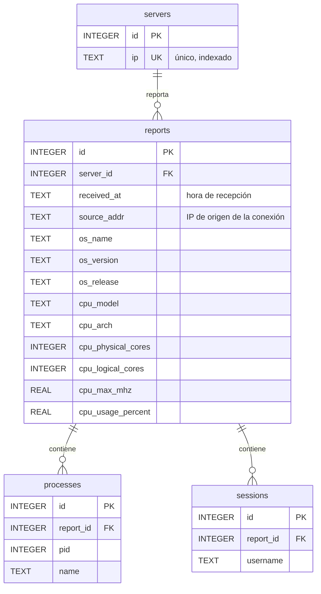

# Prex Technical Challenge - Relevamiento de Servidores

Solución con **Alternativa B (Local / Docker)**: un **agente** multiplataforma (Windows/Linux) que releva información del sistema operativo y una **API** dockerizada que la almacena en JSON plano y en SQLite normalizada.

## Arquitectura

```
┌──────────────┐  POST /api/v1/reports (Bearer token)  ┌──────────────────────┐
│ agent.py     │ ────────────────────────────────────▶ │ API Flask (Docker)   │
│ psutil +     │                                        │  ├ data/<IP>_<fecha>.json
│ platform     │ ◀──── GET /api/v1/reports/<ip> ─────── │  └ data/inventory.db (SQLite)
└──────────────┘                                        └──────────────────────┘
```

El agente corre en cada equipo, recolecta los datos locales y los **envía** (modelo *push*) a la API, que los centraliza. Se eligió *push* en lugar de *pull* (que el servidor consulte a cada equipo) porque así el servidor no necesita conectarse a los equipos relevados: solo los agentes inician conexiones, y eso simplifica el firewall cuando hay equipos detrás de NAT.

> **Referencia:** el esquema de agente + servidor central es el patrón habitual de las herramientas de inventario y monitoreo. El modelo *push* de esta solución equivale a los agentes "activos" de [Zabbix](https://www.zabbix.com/documentation/current/en/manual/concepts/agent) y al [Datadog Agent](https://docs.datadoghq.com/agent/); el modelo *pull* es el de los agentes "pasivos" de Zabbix y el de [Prometheus](https://prometheus.io/docs/introduction/overview/).

### Agente (`agent/agent.py`)
Recolecta:
| Requisito | Fuente |
|---|---|
| Información del procesador | `platform.processor()`, `psutil.cpu_count/cpu_freq/cpu_percent` |
| Procesos corriendo | `psutil.process_iter()` (pid y nombre) |
| Usuarios con sesión abierta | `psutil.users()` (nombre de usuario) |
| Nombre del SO | `platform.system()` |
| Versión del SO | `platform.version()` / `platform.release()` |

Además envía la IP del equipo, que identifica al servidor y da nombre al archivo. Se eligió `psutil` porque abstrae las diferencias entre Windows y Linux con una sola base de código.

### API (`api/app.py`)
| Método | Endpoint | Descripción |
|---|---|---|
| `POST` | `/api/v1/reports` | Recibe el relevamiento del agente y lo almacena |
| `GET` | `/api/v1/reports/<ip>` | Devuelve la información de una IP (opcional `?date=AAAA-MM-DD`) |
| `GET` | `/health` | Estado del servicio |

**Códigos de respuesta**

Todas las respuestas son JSON. Los errores siguen el estándar **Problem Details (RFC 9457)**, con `Content-Type: application/problem+json` y mensajes en inglés, como es convención en las APIs HTTP:

```json
{
  "type": "about:blank",
  "title": "Bad Request",
  "status": 400,
  "detail": "Missing fields: cpu, processes."
}
```

- `title` es el nombre estándar del código HTTP.
- `detail` explica el caso concreto.
- Los `401` incluyen además el encabezado `WWW-Authenticate: Bearer` (RFC 6750).

| Código | Significado | Cuándo ocurre |
|---|---|---|
| `200` OK | Consulta exitosa | `GET /health`, `GET /api/v1/reports/<ip>` con datos |
| `201` Created | Relevamiento guardado | `POST /api/v1/reports` exitoso |
| `400` Bad Request | Pedido mal formado | Body que no es JSON, campos faltantes, `cpu` que no es un objeto, `processes`/`users` que no son listas de objetos, IP o fecha inválidas |
| `401` Unauthorized | Sin autenticación válida | Token ausente o incorrecto |
| `404` Not Found | Recurso inexistente | No hay datos para esa IP (o para esa IP en la fecha pedida), ruta desconocida |
| `405` Method Not Allowed | Método no soportado | Por ejemplo `DELETE /api/v1/reports` |
| `413` Payload Too Large | Body demasiado grande | Request de más de 5 MB |
| `500` Internal Server Error | Falla del servidor | Configuración faltante o error inesperado. Al cliente solo le llega `"An unexpected error occurred."`; el detalle queda en el log (`docker compose logs api`). |

## Modelo de datos

Cada envío del agente es una "foto" del servidor en ese momento (`reports`). Los procesos y las sesiones de esa foto cuelgan de ella.



- Las claves foráneas se hacen cumplir con `PRAGMA foreign_keys = ON`, porque SQLite no las controla por defecto.
- Hay índices en `reports.server_id`, `processes.report_id` y `sessions.report_id`, que son las columnas por las que se cruzan las tablas. `servers.ip` no necesita un índice aparte, ya que `UNIQUE` lo crea automáticamente.

**Almacenamiento**
- **JSON plano** `data/<IP>_<AAAA-MM-DD>.json` (requisito). Si un mismo servidor reporta varias veces en el día, los envíos se acumulan en una lista para no perder historial.
- **SQLite normalizada** `data/inventory.db` (deseable), con el modelo de arriba.
- Ambos se escriben como **una sola operación atómica**: o se guardan los dos, o ninguno (ver "Guardado atómico de JSON y base").

### Datos guardados respecto de la consigna

Se guarda únicamente lo que pide la consigna, más lo indispensable para que la aplicación funcione y para la seguridad.

| Pide la consigna | Se guarda |
|---|---|
| Información del procesador | Modelo, arquitectura, núcleos físicos y lógicos, frecuencia máxima, % de uso |
| Procesos corriendo | Nombre y PID de cada proceso (el PID distingue varias instancias de un mismo programa) |
| Usuarios con sesión abierta | Nombre de usuario de cada sesión |
| Nombre y versión del SO | `os_name`, `os_version`, `os_release` |

Datos adicionales, y por qué son necesarios:
- **`ip`** (funcionamiento): identifica al servidor y da nombre al archivo `<IP>_<fecha>.json`.
- **`received_at`** (funcionamiento): fecha y hora de recepción. Distingue los envíos de un mismo día y la registra el servidor, no el agente, así que no depende del reloj del equipo relevado.
- **`source_addr`** (seguridad): la IP desde la que llegó la conexión. La `ip` la declara el agente; comparándola con esta se puede detectar si alguien envía datos haciéndose pasar por otro servidor. Hoy solo se registra, no se compara automáticamente, porque ambas pueden diferir legítimamente: con NAT, VPN, proxies o balanceadores, o en equipos con varias interfaces de red. Con Docker Desktop, por ejemplo, la API ve la IP del gateway de Docker (`172.17.0.1`) en lugar de la del equipo.

La API **descarta cualquier otro campo** que llegue en el envío, así que solo se almacena lo de esta lista aunque un cliente mande más.

## Decisiones de diseño

**Flask como framework web.** Es liviano y alcanza para una API de pocos endpoints. Se descartó Django porque incorpora ORM, panel de administración y plantillas que no se usan. FastAPI era una alternativa válida (validación automática de datos y documentación OpenAPI generada); se priorizó la simplicidad de Flask para este alcance.

**Ejecución del agente bajo demanda.** El agente releva y envía una vez por ejecución. Para mantener el inventario actualizado en producción se programaría con `cron` (Linux) o el Programador de tareas (Windows); quedó fuera del alcance.

**Límite de 5 MB por request.** Flask no limita el tamaño del body por defecto, y un envío desmedido podría agotar la memoria o el disco del servidor. El valor surge de medir un relevamiento real: 318 procesos ocupan ~23 KB (~71 bytes por proceso), así que 5 MB alcanza para unos 70.000 procesos, muy por encima de cualquier servidor real.

**SQLite como base de datos.**
- Viene incluida en Python: no requiere instalar, asegurar ni mantener un servidor de base de datos aparte.
- Es un único archivo en el mismo volumen que los JSON, y el backup se reduce a copiar `data/`.
- El volumen de escrituras esperado (agentes que reportan periódicamente) es bajo.
- Usa SQL estándar, así que el modelo y las consultas se pueden migrar a PostgreSQL si el sistema crece.
- Limitación: admite una escritura a la vez. Como referencia, 5.000 servidores reportando cada 5 minutos serían ~17 envíos por segundo y ~430 millones de filas de procesos por día, y el JSON de cada servidor llegaría a ~6,6 MB diarios, que se reescriben completos en cada envío. A esa escala se evolucionaría a:
  1. **PostgreSQL**, que admite escrituras concurrentes.
  2. Una **cola de mensajes** entre la API y la base, para absorber picos de envíos.
  3. Una **política de retención** y un formato de archivo de solo agregado (por ejemplo, JSON Lines) en lugar de reescribir el JSON diario.

**SQLite en lugar de MongoDB.** MongoDB era una alternativa válida, dado que el agente envía JSON. Se descartó porque:
- La copia fiel del documento original ya la cubren los archivos `.json`.
- Los datos tienen relaciones claras y estables (servidor → relevamientos → procesos y sesiones), que se modelan mejor en una base relacional.
- Las consultas de mayor valor cruzan servidores (por ejemplo, en qué servidores corre un proceso o qué usuario tiene sesión en varios), y en SQL son simples.
- Agregaría un servicio más para levantar, asegurar y mantener.

**Doble almacenamiento: JSON y base de datos.** El JSON es requisito de la consigna y conserva una copia legible de cada envío, útil para auditoría. La base permite consultar y cruzar información entre servidores.

**Guardado atómico de JSON y base.** Para que nunca quede uno guardado sin el otro, `store_report` ejecuta todo dentro de una transacción:
1. `BEGIN IMMEDIATE` toma el lock de escritura de SQLite.
2. El JSON nuevo se escribe en un archivo temporal y se insertan las filas sin confirmar.
3. `os.replace` reemplaza el archivo del día de forma atómica.
4. `COMMIT`. Ante cualquier falla previa se hace `ROLLBACK` y se restaura el JSON anterior.

El lock del paso 1 también serializa los envíos simultáneos entre los workers de gunicorn, que de otro modo podían pisarse el JSON del día y perder un envío. Lo verifica un test con 3 procesos escribiendo en simultáneo.

Limitación: un archivo y una base no comparten una transacción real. Si fallaran el `COMMIT` y también la restauración del archivo, quedarían desincronizados. Es un caso muy improbable.

**Dependencias con versión fija.** Los `requirements.txt` fijan versiones exactas (`==`) en lugar de mínimas (`>=`), para que cada instalación sea idéntica a la probada y una versión nueva, incompatible o comprometida, no se incorpore sin control. `werkzeug` se declara explícitamente aunque Flask ya lo instala, porque la API lo importa de forma directa. Las dependencias de desarrollo (`pytest`) están en un archivo aparte, `api/requirements-dev.txt`, para que no se instalen en la imagen de producción.

**Nombres de archivo compatibles con IPv6.** Las IPv6 contienen `:`, un carácter que Windows no admite en nombres de archivo. En el nombre del archivo se reemplaza por `-` (por ejemplo, `fe80--1_<fecha>.json`); la consulta sigue usando la IP original.

**Tests automatizados y CI.** La API tiene una suite de `pytest` (`api/tests/`) que cubre cada endpoint, todos los códigos de error, la validación contra path traversal y SQL injection, el rollback ante fallas de la base y la escritura concurrente desde varios procesos. Un workflow de GitHub Actions (`.github/workflows/ci.yml`) la ejecuta en cada push y pull request:
- **Tests en Linux y Windows**, porque el agente es multiplataforma. Esta matriz detectó el problema de los nombres de archivo con IPv6, que solo ocurre en Windows.
- **Prueba de punta a punta con Docker**: levanta la API con `docker compose`, ejecuta el agente real contra ella, verifica que se guardaron el JSON y la base, y que un token incorrecto es rechazado.
- El workflow tiene permisos de solo lectura sobre el repositorio (mínimo privilegio).

**Fechas en UTC.** `received_at` se registra en UTC con la zona explícita (`2026-10-29T02:28:40+00:00`) y la fecha del archivo `<IP>_<AAAA-MM-DD>.json` es la de ese mismo instante en UTC. Así el resultado no depende de la zona horaria del servidor o del contenedor, y los relevamientos de servidores en distintas zonas son comparables.

**Errores con formato estándar.** Todas las respuestas de error siguen Problem Details (RFC 9457), con mensajes en inglés, que es la convención en APIs HTTP. Los errores del servidor no exponen detalles internos al cliente; el detalle queda en el log.

## Consideraciones de seguridad
- **Autenticación** por token compartido (`Authorization: Bearer`), comparado con `hmac.compare_digest` para evitar timing attacks. Ambos endpoints la requieren, porque la información de procesos y usuarios es sensible para un atacante (sirve para reconocimiento).
- **Validación de entrada**: la IP se valida con el módulo `ipaddress`. Como la IP forma parte del nombre del archivo, esto también **previene path traversal**. Además se validan los campos obligatorios, los tipos y el formato de la fecha.
- **Consultas parametrizadas** (`?`) en todo el SQL. Los nombres de procesos y usuarios los controla cualquiera con acceso al servidor relevado, así que se tratan como datos no confiables.
- **Errores sin detalles internos**: el cliente recibe mensajes genéricos ante errores del servidor y el detalle queda solo en el log.
- **Límite de tamaño** del request (5 MB) para mitigar abusos.
- **Contenedor sin root**: la API corre con un usuario sin privilegios (uid 1000 por defecto) que solo puede escribir en `data/`. En Linux, el contenedor debe correr con el mismo uid que el dueño de la carpeta `data/` del host; por eso el uid es configurable (`APP_UID`/`APP_GID`) en lugar de volver a root. Si se explotara una falla en la aplicación, el atacante quedaría limitado a esos permisos: no podría modificar el resto del contenedor ni instalar herramientas, y se reducen las posibilidades de escapar del contenedor al host.
- **Secretos fuera del código**: el token se configura por variable de entorno y el `.env` está excluido de git.
- **Datos mínimos**: la API guarda solo los campos de la consigna y los necesarios para funcionar y para la seguridad; descarta el resto.
- **Token por variable de entorno**: el agente lo toma de `AGENT_TOKEN`. Pasarlo con `--token` lo deja visible en la lista de procesos y en el historial de la terminal.
- **Mejoras para producción** (fuera del alcance): rotación de tokens, rate limiting, logs de auditoría, cifrado en reposo y política de retención de datos.

### Relación con el OWASP Top 10:2025

| Riesgo OWASP (edición 2025) | Cómo se aborda acá |
|---|---|
| **A01 Broken Access Control** (incluye path traversal, CWE-22) | La IP se valida antes de usarla en el nombre del archivo; ambos endpoints exigen token |
| **A02 Security Misconfiguration** | Si falta `AGENT_TOKEN`, la API se niega a atender en vez de quedar abierta; contenedor sin root |
| **A03 Software Supply Chain Failures** | Dependencias con versión fija y declaradas explícitamente en los `requirements.txt` |
| **A04 Cryptographic Failures** | **Riesgo pendiente**: hoy el tráfico viaja sin cifrar (ver "Riesgos conocidos") |
| **A05 Injection** (incluye SQL injection, CWE-89) | Consultas parametrizadas |
| **A07 Authentication Failures** | Token comparado en tiempo constante (`hmac.compare_digest`). **Riesgo pendiente**: token único compartido (ver "Riesgos conocidos") |
| **A10 Mishandling of Exceptional Conditions** | Manejo centralizado de errores, mensajes genéricos al cliente, transacción con rollback ante fallas |

### Riesgos conocidos

**Tráfico sin cifrar (HTTP en lugar de HTTPS).** La API atiende en HTTP plano, por lo que el token y los datos relevados viajan sin cifrar y el token podría ser interceptado en la red. La mitigación es servir la API por HTTPS (TLS), mediante un *reverse proxy* (Caddy, Nginx) o certificados configurados en gunicorn. Quedó fuera del alcance porque requiere generar y distribuir certificados en los que confíen los agentes.

**Token único compartido.** Todos los agentes usan el mismo token, que además habilita tanto el envío como la consulta. Si se compromete un servidor relevado, con su token se podría leer el inventario completo e inyectar relevamientos a nombre de cualquier IP; tampoco es posible revocar el acceso de un solo agente ni distinguirlos en los logs. La mitigación es una credencial por agente con permiso solo de escritura (token individual o mTLS) y una credencial separada para consultas.

**Relevamientos perdidos si la API no está disponible.** El agente hace un único intento de envío: si la API está caída o la red falla, el relevamiento se pierde y el agente termina con error. La atomicidad del guardado no cubre este caso, porque el envío nunca llega al servidor. La mitigación tiene tres partes: reintentos con espera exponencial ante errores de red y respuestas 5xx (no ante 4xx, que no se resuelven reintentando); almacenamiento local de los envíos fallidos para reenviarlos en la siguiente ejecución; e idempotencia, mediante un identificador único por relevamiento, para que un reintento de un envío que sí llegó no genere duplicados.

## Tests

La suite está en `api/tests/test_app.py` (40 casos, incluidos los parametrizados). Cada test arranca con un almacenamiento vacío y propio, en una carpeta temporal, así que nunca toca el `data/` real.

**Envío de relevamientos (`POST /api/v1/reports`)**

| Test | Qué verifica |
|---|---|
| `test_envio_valido_se_guarda_en_json_y_en_la_base` | Un envío correcto responde 201 y queda guardado en el JSON del día y en las cuatro tablas |
| `test_la_fecha_de_recepcion_esta_en_utc_y_coincide_con_el_archivo` | `received_at` está en UTC (`+00:00`) y su fecha coincide con la del nombre del archivo |
| `test_varios_envios_del_mismo_dia_se_acumulan` | Varios envíos del mismo día se agregan al JSON sin pisarse, y el servidor no se duplica en la base |
| `test_campos_no_pedidos_se_descartan` | Los campos que no pide la consigna (por ejemplo `hostname` o la línea de comandos de un proceso) no se guardan |
| `test_sin_token_devuelve_401` | Sin token se rechaza con 401 y encabezado `WWW-Authenticate: Bearer` |
| `test_token_incorrecto_devuelve_401` | Un token incorrecto se rechaza con 401 |
| `test_falta_un_campo_obligatorio_devuelve_400` | Si falta cualquiera de los 6 campos obligatorios, responde 400 indicando cuál |
| `test_tipo_invalido_devuelve_400` | `cpu` que no es objeto, `processes` que no es lista o `users` con elementos que no son objetos dan 400 |
| `test_body_que_no_es_json_devuelve_400` | Un body que no es JSON da 400 |
| `test_ip_invalida_devuelve_400_y_no_escribe_archivos` | IPs inválidas o con path traversal (`../../etc/passwd`) dan 400 y no se escribe ningún archivo |
| `test_ipv6_se_guarda_con_un_nombre_de_archivo_valido_en_windows` | Una IPv6 se guarda con `-` en lugar de `:` en el nombre del archivo y se puede consultar |
| `test_body_mayor_a_5mb_devuelve_413` | Un body de más de 5 MB se rechaza con 413 |

**Consulta (`GET /api/v1/reports/<ip>`)**

| Test | Qué verifica |
|---|---|
| `test_consulta_devuelve_los_envios_agrupados_por_fecha` | La consulta devuelve los envíos de la IP agrupados por fecha |
| `test_consulta_filtrando_por_fecha` | El filtro `?date=` devuelve solo esa fecha |
| `test_consulta_sin_token_devuelve_401` | La consulta también exige token |
| `test_ip_sin_datos_devuelve_404` | Una IP sin relevamientos da 404 |
| `test_fecha_sin_datos_devuelve_404` | Una fecha sin relevamientos da 404 |
| `test_fecha_invalida_devuelve_400` | Fechas mal formadas o inexistentes (`5`, `2026-13-01`, `ayer`) dan 400 |

**Manejo de errores**

| Test | Qué verifica |
|---|---|
| `test_health_responde_ok` | `/health` responde 200 |
| `test_metodo_no_permitido_devuelve_405` | Un método no soportado da 405 en formato Problem Details |
| `test_ruta_inexistente_devuelve_404` | Una ruta desconocida da 404 en formato Problem Details |
| `test_token_no_configurado_devuelve_500_sin_detalles` | Sin `AGENT_TOKEN` configurado responde 500 sin revelar el motivo al cliente |
| `test_error_inesperado_devuelve_500_generico` | Un error no previsto responde 500 genérico, sin filtrar el detalle interno |

Todos los tests de error verifican además que la respuesta cumpla el formato RFC 9457 (`application/problem+json` con `type`, `title`, `status` y `detail`).

**Guardado atómico, concurrencia y base de datos**

| Test | Qué verifica |
|---|---|
| `test_si_falla_la_base_el_json_queda_como_estaba` | Si la base falla a mitad del guardado, el JSON y la base quedan como antes y no quedan archivos temporales |
| `test_si_falla_el_commit_se_restaura_el_json` | Si falla el `COMMIT`, se restaura el JSON anterior |
| `test_envios_simultaneos_desde_varios_procesos_no_se_pierden` | 3 procesos enviando 20 relevamientos a la vez (como los workers de gunicorn): los 60 quedan en el JSON y en la base |
| `test_sql_injection_se_guarda_como_texto` | Un nombre de proceso con SQL malicioso se guarda como texto y las tablas siguen intactas |
| `test_las_claves_foraneas_estan_activas` | La base rechaza un proceso que apunta a un relevamiento inexistente |

**CI (`.github/workflows/ci.yml`)**

| Job | Qué hace |
|---|---|
| Tests (ubuntu-latest, windows-latest) | Corre la suite y el agente en modo `--dry-run` en ambos sistemas |
| Docker de punta a punta | Solo si los tests pasaron: levanta la API con `docker compose`, ejecuta el agente real, verifica que se guardaron el JSON y la base, y que un token incorrecto da 401 |

## Requisitos
- Docker (Docker Desktop en Windows/macOS) para la API
- Python 3.9+ para el agente

## Ejecución

### 1. Levantar la API
```bash
cp .env.example .env          # en Windows: copy .env.example .env
# editar .env y definir AGENT_TOKEN con un valor largo y aleatorio
# solo Linux, si `id -u` no es 1000: definir también APP_UID y APP_GID en .env
docker compose up -d --build
curl http://localhost:5000/health
```

### 2. Ejecutar el agente
```bash
cd agent
pip install -r requirements.txt      # librerías: psutil, requests
export AGENT_TOKEN=<token>           # PowerShell: $env:AGENT_TOKEN="<token>"
python agent.py --api http://localhost:5000
# Vista previa sin enviar:
python agent.py --dry-run
```
Para relevar otra máquina de la red local, apuntar `--api` a la IP local del host donde corre Docker (ej. `http://192.168.1.10:5000`).

### 3. Consultar
```bash
curl -H "Authorization: Bearer <AGENT_TOKEN>" http://localhost:5000/api/v1/reports/<IP>
```

### 4. Tests
```bash
cd api
pip install -r requirements-dev.txt
pytest -v
```

### Ejecutar la API sin Docker (opcional)
```bash
cd api && pip install -r requirements.txt
AGENT_TOKEN=<token> python app.py
```
