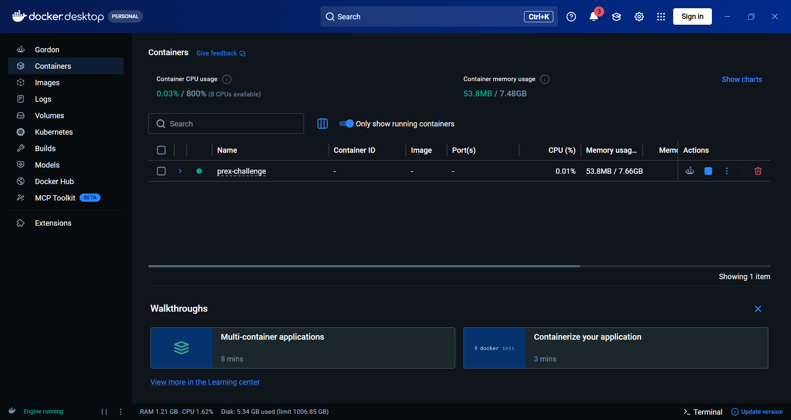
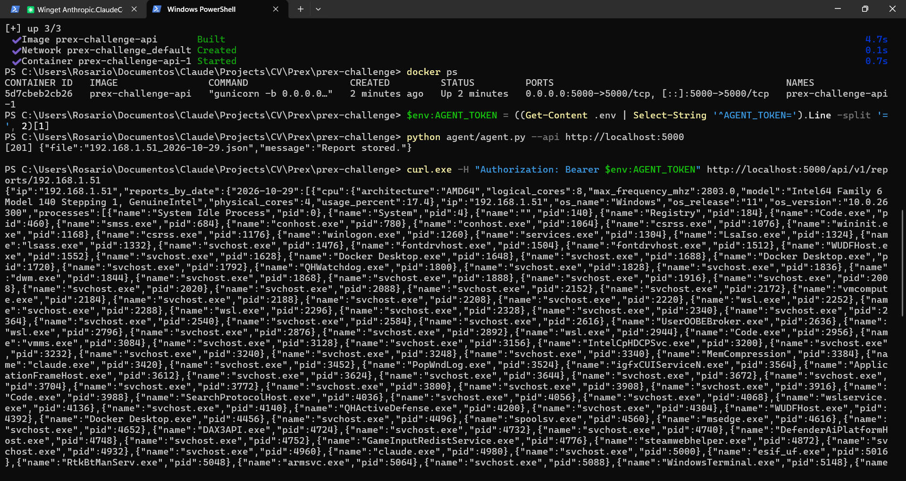
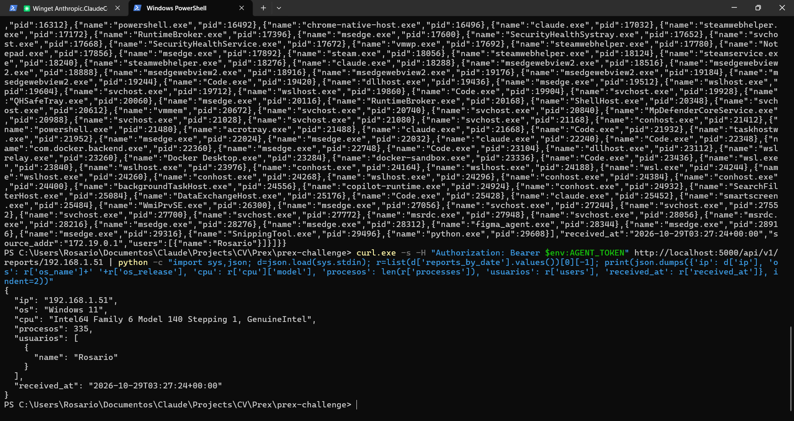
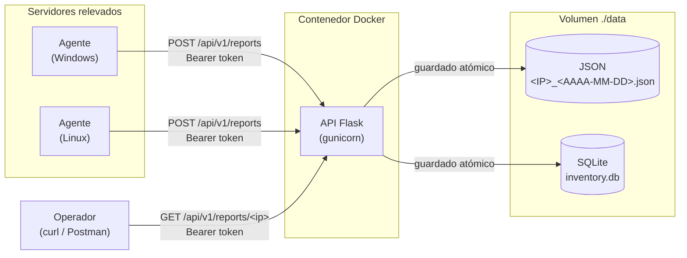
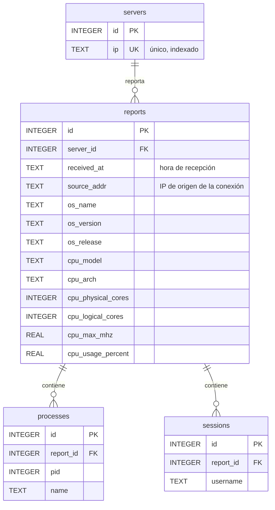

# Prex Technical Challenge - Relevamiento de Servidores

Un **agente** multiplataforma (Windows/Linux) releva información del sistema operativo y la envía a una **API** dockerizada, que la almacena en JSON plano y en SQLite normalizada. Implementado con la **Alternativa B (Local / Docker)**.

## Cumplimiento de la consigna

| Requisito | Dónde se resuelve |
|---|---|
| Agente ejecutable en Windows y Linux | `agent/agent.py` con `psutil`; probado en ambos sistemas en CI |
| Información del procesador, procesos corriendo, usuarios con sesión abierta, nombre y versión del SO | `agent/agent.py` (ver [Datos relevados](#datos-relevados)) |
| Endpoint para que el agente envíe la información | `POST /api/v1/reports` |
| Almacenamiento en JSON de texto plano `<IP de servidor>_<AAAA-MM-DD>.json` | `data/`, un archivo por IP y por día |
| Endpoint de consulta por IP | `GET /api/v1/reports/<ip>` |
| Código en GitHub, instrucciones y descripción | Este repositorio y este README |
| Evidencia del contenedor corriendo y una consulta exitosa con curl | [Evidencia](#evidencia) |
| *Deseable:* aplicación dockerizada | `api/Dockerfile` y `docker-compose.yml` |
| *Deseable:* base de datos normalizada | SQLite en `data/inventory.db` (ver [Modelo de datos](#modelo-de-datos)) |

## Ejecución

**Requisitos:** Docker (Docker Desktop en Windows/macOS) para la API y Python 3.9+ para el agente.

```bash
# 1. Levantar la API
cp .env.example .env          # Windows: copy .env.example .env
# Editar .env y definir AGENT_TOKEN con un valor largo y aleatorio.
# Solo Linux, si `id -u` no es 1000: definir también APP_UID y APP_GID.
docker compose up -d --build
curl http://localhost:5000/health

# 2. Ejecutar el agente
pip install -r agent/requirements.txt      # librerías: psutil, requests
export AGENT_TOKEN=<token>                 # PowerShell: $env:AGENT_TOKEN="<token>"
python agent/agent.py --api http://localhost:5000
python agent/agent.py --dry-run            # muestra el relevamiento sin enviarlo

# 3. Consultar
curl -H "Authorization: Bearer <token>" http://localhost:5000/api/v1/reports/<IP>

# 4. Tests
pip install -r api/requirements-dev.txt
cd api && pytest -v
```

## Evidencia

**Contenedor corriendo en Docker Desktop**



**`docker ps`, envío del agente (`201`) y consulta con `curl`**



**Consulta resumida:** IP, sistema operativo, CPU, cantidad de procesos, usuarios con sesión y fecha de recepción en UTC.



## Arquitectura



El agente corre en cada equipo y **envía** los datos a la API (modelo *push*). Se eligió *push* en lugar de *pull* (que la API se conecte a cada equipo a pedirle los datos) porque así los equipos relevados no exponen ningún puerto: solo abren conexiones salientes hacia la API. Eso reduce la superficie de ataque de cada servidor y funciona aunque estén detrás de NAT o de un firewall que bloquee conexiones entrantes.

> **Referencia:** es el patrón habitual de las herramientas de inventario y monitoreo. El modelo *push* equivale a los agentes "activos" de [Zabbix](https://www.zabbix.com/documentation/current/en/manual/concepts/agent) y al [Datadog Agent](https://docs.datadoghq.com/agent/); el *pull*, a los agentes "pasivos" de Zabbix y a [Prometheus](https://prometheus.io/docs/introduction/overview/).

### Datos relevados

Se guarda solo lo que pide la consigna, más lo indispensable para el funcionamiento y la seguridad. La API descarta cualquier otro campo que llegue.

| Dato | Contenido | Fuente |
|---|---|---|
| Procesador | Modelo, arquitectura, núcleos físicos y lógicos, frecuencia máxima, % de uso | `platform`, `psutil` |
| Procesos | Nombre y PID (el PID distingue instancias de un mismo programa) | `psutil.process_iter()` |
| Usuarios con sesión | Nombre de usuario de cada sesión | `psutil.users()` |
| Sistema operativo | Nombre, versión y release | `platform` |
| `ip` | IP declarada por el agente: identifica al servidor y da nombre al archivo | Agente |
| `received_at` | Fecha y hora de recepción, en UTC | API |
| `source_addr` | IP de origen de la conexión, para detectar envíos a nombre de otro servidor | API |

`source_addr` solo se registra, no se compara con `ip`, porque pueden diferir legítimamente (NAT, VPN, proxies, varias interfaces de red; con Docker la API ve la IP del gateway de la red de Docker, por ejemplo `172.19.0.1`).

## API

| Método | Endpoint | Descripción |
|---|---|---|
| `POST` | `/api/v1/reports` | Recibe el relevamiento del agente y lo almacena |
| `GET` | `/api/v1/reports/<ip>` | Devuelve los relevamientos de una IP, agrupados por fecha (opcional `?date=AAAA-MM-DD`) |
| `GET` | `/health` | Estado del servicio |

Los errores siguen el estándar **Problem Details (RFC 9457)**, con `Content-Type: application/problem+json` y mensajes en inglés, por convención en APIs HTTP:

```json
{"type": "about:blank", "title": "Bad Request", "status": 400, "detail": "Missing fields: cpu."}
```

| Código | Cuándo ocurre |
|---|---|
| `200` | Consulta exitosa |
| `201` | Relevamiento guardado |
| `400` | Body que no es JSON, campos faltantes o con tipo incorrecto, IP o fecha inválidas |
| `401` | Token ausente o incorrecto (incluye `WWW-Authenticate: Bearer`) |
| `404` | Sin datos para esa IP o fecha, o ruta inexistente |
| `405` | Método no soportado |
| `413` | Body de más de 5 MB |
| `500` | Configuración faltante o error inesperado; el detalle queda solo en el log del servidor |

## Modelo de datos

Cada envío es una "foto" del servidor en ese momento (`reports`), de la que cuelgan sus procesos y sesiones.



Las claves foráneas se hacen cumplir con `PRAGMA foreign_keys = ON` (SQLite no las controla por defecto), y hay índices en las columnas por las que se cruzan las tablas. En el JSON, los envíos de un mismo servidor en el día se acumulan en una lista.

## Decisiones de diseño

**Flask como framework.** Liviano y suficiente para pocos endpoints. Django incorpora ORM, panel de administración y plantillas que no se usan; FastAPI era una alternativa válida, pero se priorizó la simplicidad de Flask.

**SQLite, y no MongoDB.** SQLite viene incluida en Python, no requiere un servidor aparte y es un único archivo en el mismo volumen que los JSON. Se descartó MongoDB porque la copia fiel de cada documento ya la cubren los JSON, los datos tienen relaciones estables que se modelan mejor en una base relacional, y las consultas de mayor valor cruzan servidores (por ejemplo, en qué servidores corre un proceso), algo simple en SQL.

*Límite de escala:* SQLite admite una escritura a la vez. Con 5.000 servidores reportando cada 5 minutos (~17 envíos por segundo, ~430 millones de filas de procesos por día, JSON de ~6,6 MB diarios por servidor reescritos en cada envío) se evolucionaría a PostgreSQL, una cola de mensajes para absorber picos y una política de retención con archivos de solo agregado (JSON Lines). Al usar SQL estándar, el modelo se migra casi sin cambios.

**Guardado atómico de JSON y base.** Para que nunca quede uno guardado sin el otro, todo ocurre dentro de una transacción: `BEGIN IMMEDIATE` toma el lock de escritura, el JSON nuevo se escribe en un temporal y se insertan las filas, `os.replace` reemplaza el archivo de forma atómica y recién entonces se hace `COMMIT`. Ante cualquier falla se hace `ROLLBACK` y se restaura el JSON anterior. El lock también evita que dos workers de gunicorn se pisen el JSON del día. *Limitación:* si fallaran el `COMMIT` y también la restauración del archivo, quedarían desincronizados; es un caso muy improbable.

**Límite de 5 MB por request.** Flask no limita el tamaño del body, y un envío desmedido podría agotar memoria o disco. Un relevamiento real medido (318 procesos) ocupa ~23 KB, así que 5 MB deja un margen de unos 70.000 procesos.

**Fechas en UTC.** `received_at` se registra con zona explícita (`+00:00`) y la fecha del archivo se toma de ese mismo instante, así el resultado no depende de la zona horaria del servidor o del contenedor.

**Nombres de archivo con IPv6.** Windows no admite `:` en nombres de archivo, así que en el nombre se reemplaza por `-` (`fe80--1_<fecha>.json`); la consulta usa la IP original.

**Ejecución del agente bajo demanda.** Cada ejecución releva y envía una vez. En producción se programaría con `cron` (Linux) o el Programador de tareas (Windows).

**Dependencias con versión fija.** Los `requirements.txt` usan `==` para que cada instalación sea idéntica a la probada y no se incorpore sin control una versión incompatible o comprometida. `werkzeug` se declara aunque Flask lo instala, porque la API lo importa directamente, y `pytest` va en un archivo aparte para no instalarlo en la imagen de producción.

## Tests y CI

La suite de `pytest` (40 casos) cubre cada endpoint, todos los códigos de error, path traversal, SQL injection, el rollback ante fallas de la base y la escritura concurrente desde varios procesos. El detalle de cada test está en [`api/tests/README.md`](api/tests/README.md).

GitHub Actions (`.github/workflows/ci.yml`) la ejecuta en cada push y pull request, con permisos de solo lectura:
- **Tests en Linux y Windows**, porque el agente es multiplataforma. Esta matriz detectó un error con IPv6 que solo ocurría en Windows.
- **Prueba de punta a punta con Docker**, solo si los tests pasaron: levanta la API con `docker compose`, ejecuta el agente real, verifica que los datos se guardaron y que un token incorrecto es rechazado.

## Seguridad

- **Autenticación** con token Bearer en ambos endpoints, comparado con `hmac.compare_digest` para evitar timing attacks. La consulta también lo exige porque procesos y usuarios son información útil para un atacante.
- **Validación de entrada:** la IP se valida con `ipaddress`, lo que además previene path traversal (la IP forma parte del nombre del archivo). También se validan campos obligatorios, tipos y formato de fecha.
- **Consultas SQL parametrizadas**, porque los nombres de procesos y usuarios los controla cualquiera con acceso al servidor relevado.
- **Datos mínimos** y **errores sin detalles internos** hacia el cliente.
- **Contenedor sin root:** la API corre con un usuario sin privilegios (uid 1000, configurable con `APP_UID`/`APP_GID` para que coincida con el dueño de `data/` en Linux). Si se explotara una falla, el atacante quedaría limitado a escribir en `data/`.
- **Secretos fuera del código:** el token se configura por variable de entorno y `.env` está excluido de git. El agente lo toma de `AGENT_TOKEN`, porque pasarlo con `--token` lo deja visible en la lista de procesos y en el historial de la terminal.

### Relación con el OWASP Top 10:2025

| Riesgo | Cómo se aborda |
|---|---|
| **A01 Broken Access Control** (incluye path traversal) | Validación de la IP; token en ambos endpoints |
| **A02 Security Misconfiguration** | Sin `AGENT_TOKEN` la API no atiende; contenedor sin root |
| **A03 Software Supply Chain Failures** | Dependencias con versión fija y declaradas explícitamente |
| **A04 Cryptographic Failures** | **Pendiente:** tráfico sin cifrar (ver riesgos conocidos) |
| **A05 Injection** | Consultas parametrizadas |
| **A07 Authentication Failures** | Comparación en tiempo constante. **Pendiente:** token único compartido |
| **A10 Mishandling of Exceptional Conditions** | Manejo centralizado de errores y transacción con rollback |

### Riesgos conocidos

**Tráfico sin cifrar.** La API atiende en HTTP, así que el token puede ser interceptado en la red. Es la primera mejora a aplicar, porque sin cifrado ninguna credencial está protegida: servir la API por HTTPS mediante un *reverse proxy* (Caddy, Nginx) o certificados en gunicorn. En producción, con un certificado de la **CA interna** de la organización, que se puede renovar o revocar sin redistribuir nada; uno autofirmado solo sirve para pruebas, porque obliga a copiarlo a cada agente.

**Token único compartido.** Todos los agentes usan el mismo token, que sirve tanto para enviar como para consultar: comprometer un servidor permitiría leer el inventario completo e inyectar datos a nombre de cualquier IP, y no se puede revocar un solo agente. La mitigación preferida es **mTLS**: cada agente con su propio certificado de la CA interna y permiso solo de escritura, y una credencial separada para consultas. Resuelve también el riesgo anterior.

**Relevamientos perdidos si la API no está disponible.** El agente hace un único intento; si falla, el relevamiento se pierde. La mitigación es reintentar con espera exponencial ante errores de red y 5xx (no ante 4xx), guardar localmente los envíos fallidos para reenviarlos en la siguiente ejecución, y usar un identificador único por relevamiento para que los reintentos no generen duplicados.

**Otras mejoras para producción:** rotación de credenciales, rate limiting, logs de auditoría, cifrado en reposo y política de retención de datos.
